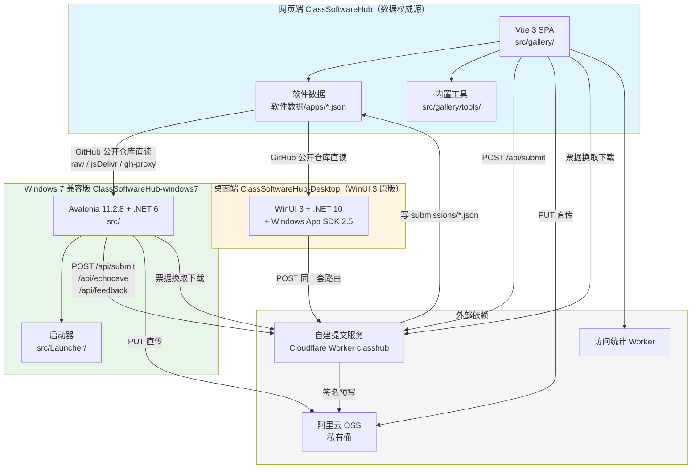
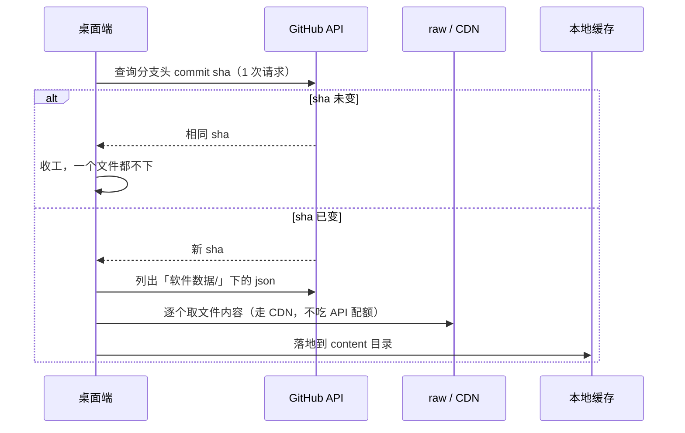
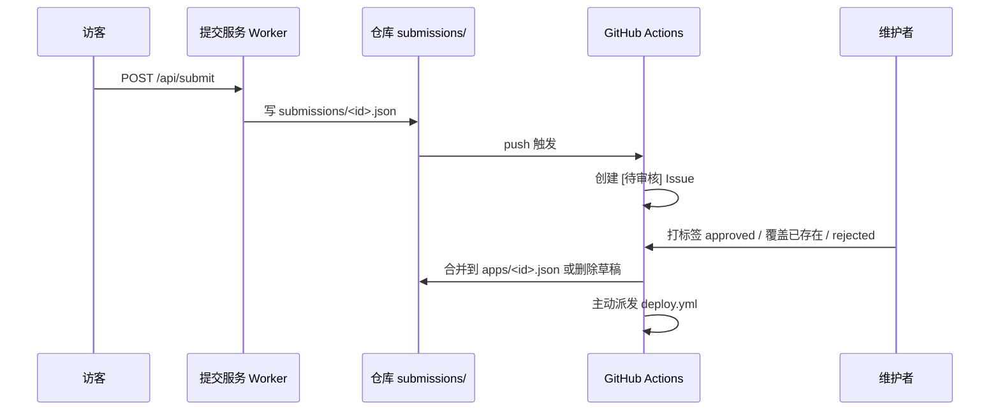

> 三个仓库的职责、依赖关系、数据流与部署形态

## 职责划分



## 依赖关系

1. **数据流向**：网页端仓库的 `软件数据/apps/*.json` 是唯一权威源。桌面端安装包**不自带内容包**，首次启动必须联网，通过 GitHub 公开仓库直读该目录（`src/Core/ShellConfig.cs:154-163`、`src/Services/GithubContentSync.cs:19-33`）。此项设计于上游 2026-10-05 定案，原因是装机残留会让已下架的软件「删了又复活」，且自带的文案文件写进缓存后再也不更新（`src/Core/ShellConfig.cs:232-235`）。
2. **提交回流**：访客通过网页端或桌面端提交软件 / 回声洞 / 反馈，写入 `submissions/*.json`，经 GitHub Actions 转为 Issue，维护者打标签后由 `review-submission.yml` 合并回 `软件数据/apps/<id>.json` 或 `回声洞/messages/`。
3. **发布隔离**：Windows 7 兼容版与 WinUI 3 原版各自独立发布、各自独立更新。Win7 版的「检查更新」与「更新日志」只读本仓库的 Release（`README.md:27`、`src/Core/ShellConfig.cs:76-82`）。
4. **可同机共存**：Windows 7 兼容版与 WinUI 3 原版的安装目录（`...\Programs\ClassSoftwareHub-Win7`）与 Inno Setup 的 `AppId` 均不同（`BUILDING.md:69`、`installer/ClassSoftwareHub-Win7.iss:10-17`）。
5. **功能对齐**：Windows 7 兼容版以「语义等价、UI 1:1」为移植契约（`src/PORTING.md:15-24`）。

## 数据流细节

### 内容同步（桌面端）



设计要点：未登录的 GitHub 接口只有 60 次/小时，且机房通常共用一个出口 IP，因此同步前先用 1 次请求判断 sha 是否变化，未变则直接返回。文件内容走 CDN（jsDelivr）与 gh-proxy 镜像，因为 `raw.githubusercontent.com` 在国内 / 校园网经常不通（`src/Services/GithubContentSync.cs:26-33`）。

### 提交与审核



## 部署形态

| 形态 | 产物 | 部署目标 |
| --- | --- | --- |
| 网页端 | `dist/`（`index.html` + `assets/`，约 72 个文件） | GitHub Pages、FTP、OpenList WebDAV 三路并行 |
| 网页端单文件 | `dist/index.html`（约 2 MB） | 离线双击，**线上不使用** |
| Windows 7 兼容版便携版 | `ClassSoftwareHub-Portable-win7-dv<版本>.zip` | 用户自行下载解压 |
| Windows 7 兼容版安装版 | `ClassSoftwareHub-Setup-win7-dv<版本>.exe` | Inno Setup 6 编译 |

`deploy.yml` 只构建一次，产物由三个上传任务共用；Pages 原样发布、FTP 镜像（并删除远端已不存在的文件）、OpenList 原样上传（不压缩）并清理构建产生的 `assets/` 层。`vite.config.ts` 设置 `base: './'`，使同一份产物同时适配根目录与子目录两种形态；hash 路由保证文档路径不变（`AGENTS.md:496-501`）。

## 桌面端两层产物结构

```
ClassSoftwareHub.exe      ← 启动器（src/Launcher，自包含 + 裁剪 + 单文件，约 9 MB）
app\                      ← 应用本体（publish 产物，含 content\ 与 ContentIcons\）
使用说明.txt              ← 便携版才有
```

好处：以后更新只换 `app\` 子目录，启动器不动，桌面上快捷方式指向的路径永远有效（`BUILDING.md:22-32`）。
