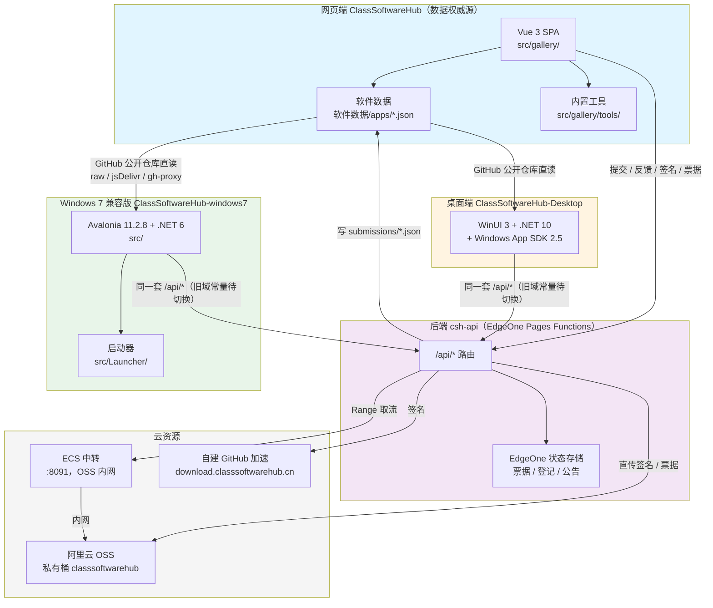
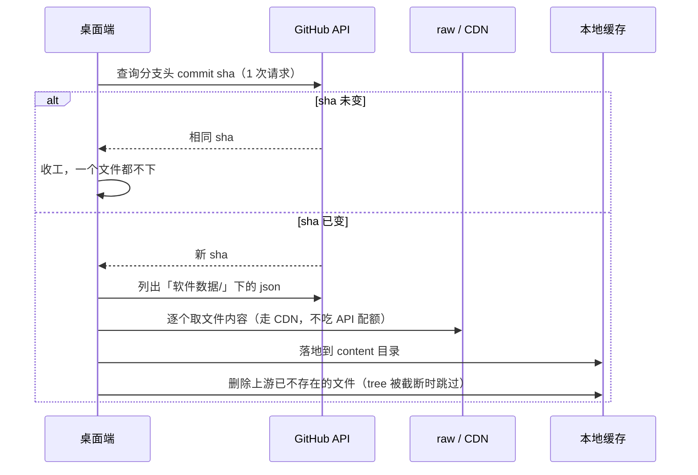
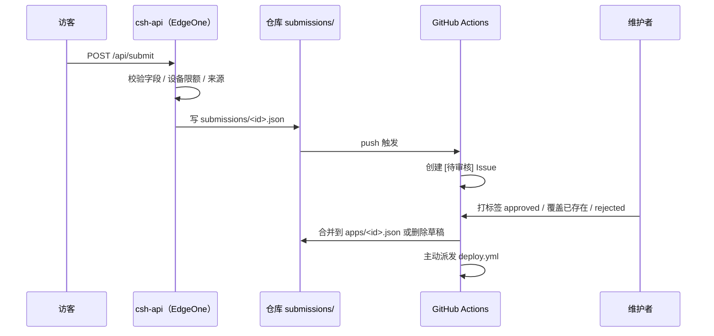
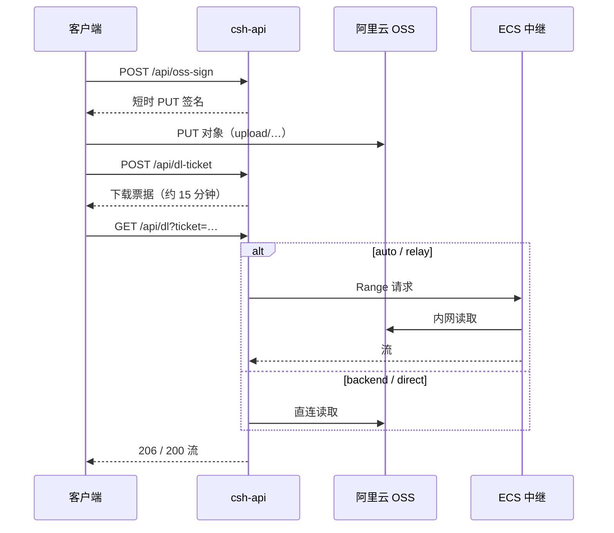

> 四个仓库的职责、依赖关系、数据流与部署形态

## 职责划分



## 依赖关系

1. **数据流向**：网站仓库的 `软件数据/apps/*.json` 是唯一权威源。两个桌面端安装包**不自带软件数据**，首次启动必须联网，通过 GitHub 公开仓库直读该目录（`ClassSoftwareHub-Desktop/Services/GithubContentSync.cs`、`ClassSoftwareHub-windows7/src/Services/GithubContentSync.cs`）。这样已下架的软件不会因装机残留「删了又复活」，文案也不会被旧缓存锁死。Win7 版安装包仍附带系统镜像站清单与图标，仅作离线兜底。
2. **提交回流**：访客通过网页端或桌面端提交软件 / 回声洞 / 反馈，后端校验后写入 `submissions/*.json`，GitHub Actions 转为 Issue，维护者打标签后由 `review-submission.yml` 合并回 `软件数据/apps/<id>.json` 或 `回声洞/messages/`。
3. **发布隔离**：两个桌面端使用各自的更新仓库与 AppId，独立发布、独立更新，互不接收对方版本。
4. **可同机共存**：两个桌面端安装目录、AppId 均不同（`...\Programs\ClassSoftwareHub` / `...\Programs\ClassSoftwareHub-Win7`）。
5. **后端无状态化**：函数本身不持久化业务数据；票据、登记、公告写入 EdgeOne 状态存储，文件写入 OSS。

## 数据流细节

### 内容同步（桌面端）



设计要点：未登录的 GitHub 接口只有 60 次/小时，机房通常共用一个出口 IP，因此同步前先用 1 次请求判断 sha 是否变化。文件内容走 CDN（jsDelivr）与 gh-proxy 镜像，因为 `raw.githubusercontent.com` 在国内 / 校园网经常不通。成功的入口记在 `content-base.txt`，下次优先使用。

### 提交与审核



### 文件上传与下载



### 加速签名

GitHub 文件不经过后端转发：客户端把原始地址发给 `/api/mirror-sign`，后端调用自建签名节点返回 `download.classsoftwarehub.cn/d?u=&e=&s=` 短时链接，由 nginx 校验后反代 GitHub。后端不可用或签名失败时，客户端按公共镜像列表回退。

## 部署形态

| 形态 | 产物 | 部署目标 |
| --- | --- | --- |
| 网页端 | `dist/`（`index.html` + `assets/`） | GitHub Pages、FTP、OpenList WebDAV 三路并行 |
| 网页端单文件 | `dist/index.html`（约 2 MB） | 离线双击，**线上不使用** |
| 后端 | EdgeOne Pages Functions | 腾讯 EdgeOne Pages（`api.classsoftwarehub.cn`） |
| Win10 桌面端 | `ClassSoftwareHub-Setup-dv<版本>.exe` | Inno Setup 6 编译，GitHub Releases |
| Win7 安装版 | `ClassSoftwareHub-Setup-win7-dv<版本>.exe` | Inno Setup 6 编译，GitHub Releases |
| Win7 便携版 | `ClassSoftwareHub-Portable-win7-dv<版本>.zip` | 用户自行下载解压 |

网页端 `deploy.yml` 只构建一次，产物由三个上传任务共用；`vite.config.ts` 设置 `base: './'`，使同一份产物同时适配根目录与子目录。hash 路由保证部署深度变化时路径不变。

## 桌面端产物结构

### Win10

```
ClassSoftwareHub.exe      ← 应用本体 + 依赖（自包含发布）
installer/                ← 安装脚本（不随包发布）
```

安装包直接把自包含发布产物装入 `%LOCALAPPDATA%\Programs\ClassSoftwareHub`，更新时原地替换。

### Win7

```
ClassSoftwareHub.exe      ← 启动器（src/Launcher，自包含 + 裁剪 + 单文件，约 5–9 MB）
app\                      ← 应用本体（publish 产物）
使用说明.txt              ← 便携版才有
```

好处：以后更新只换 `app\` 子目录，启动器不动，桌面快捷方式指向的路径永远有效。启动器只负责拉起 `app\ClassSoftwareHub.exe` 并转发参数，不常驻、不做单实例判断。
