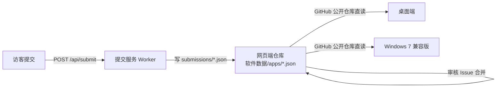

# 欢迎来到 ClassSoftwareHub！

> **把「电教委员常用软件下载站」装进教室里的每一台机器**
> 面向教室电脑与电教设备管理场景，无广告、无捆绑、开源优先。

::: warning 系统兼容性提示
Windows 7 兼容版的系统底线为 **Windows 7 SP1 及以上（x64）**。低于该版本时安装程序会拒绝安装，并引导改用网页版。
WinUI 3 原版桌面端要求 **Windows 10 1809 及以上**。两者安装目录与安装标识不同，可在同一台机器上共存。
:::

::: tip 无需运行时
桌面端为**自包含发布**（self-contained），目标机无需单独安装 .NET 运行时。WebView2 运行时为可选组件，未安装时仅「应用内网页浮层」不可用，其余功能不受影响。
:::

::: info 开源协议
本项目基于 **GNU GPL-3.0** 协议开源。你可以自由使用、修改和分发本软件，但修改后的版本必须同样以 GPL-3.0 协议开源。
:::

# 它是什么？

**ClassSoftwareHub** 是一个面向电教委员的常用软件下载站与课堂工具箱。站点收录系统工具、教学软件、教学辅助与其他工具四类常用软件，提供版本号、体积、系统限制与校验值，并给出文件直链。除下载能力外，还内置随机抽号、课堂计时、全屏时钟、编码与哈希、Markdown 预览、二维码生成、时间戳转换、系统镜像下载入口等纯本地工具。

项目由三个仓库组成同一产品的三种形态：

| 形态 | 仓库 | 技术形态 | 系统要求 |
| --- | --- | --- | --- |
| 网页端 | `ClassSoftwareHub` | Vue 3 + Vite + TypeScript 静态站点 | 任意现代浏览器 |
| 桌面端 | `ClassSoftwareHub-Desktop` | WinUI 3 + .NET 10 + Windows App SDK 2.5 | Windows 10 1809 及以上 |
| Windows 7 兼容版 | `ClassSoftwareHub-windows7` | Avalonia 11.2.8 + .NET 6 | Windows 7 SP1 及以上（x64） |

## 核心优势

- **收录干净**：无广告、无捆绑、开源优先，避免装机污染
- **一软件一数据**：软件数据为独立 JSON 文件，单条异常不影响整站
- **版本自动核对**：每周自动跟踪 GitHub Releases 与官方下载源
- **校验值透明**：MD5 / SHA 系列校验值按长度自动识别，可一键复制
- **跨形态一致**：网页端与两个桌面端共享同一份软件数据
- **老机器可用**：Windows 7 兼容版把系统底线降到 SP1

## 适用场景

- **教室机批量装机**：挑选无捆绑常用软件，批量下载
- **老旧机器使用桌面客户端**：系统无法升级至 Windows 10 的教室机
- **课堂现场工具**：随机抽号、计时、全屏时钟、截屏贴图等高频操作
- **镜像下载导航**：集中提供操作系统镜像的可信下载入口，站内不存储镜像

## 数据如何流转

两个桌面端安装包**均不自带内容包**，首次启动必须联网，从 GitHub 公开仓库直读网页端的 `软件数据/apps/*.json`。此项设计的原因是：装机残留会让已下架的软件「删了又复活」，且自带的文案文件写进缓存后再也不更新。

## 版本与发布

- **网页端**：对外版本号 `X.Y.Z` + 代号后缀，另有内部版本号 `AAAABBCCPRDD`
- **Windows 7 兼容版**：`dv` + `主.功能.补丁` + `-insider架构.迭代`
- **发布隔离**：Windows 7 兼容版与 WinUI 3 原版各自独立发布、各自独立更新，互不接收对方的版本

## 获取帮助

- 站点：[classsoftwarehub.us.ci](https://classsoftwarehub.us.ci)
- 备用站点：[classsoftwarehub.132614.xyz](https://classsoftwarehub.132614.xyz)
- 问题反馈：[GitHub Issues](https://github.com/c1201y/ClassSoftwareHub/issues)
- QQ 群：487903798
