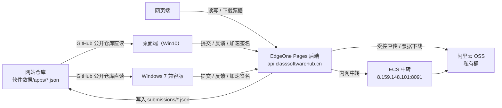

# 欢迎来到 ClassSoftwareHub！

> **把「电教委员常用软件下载站」装进教室里的每一台机器**
> 面向教室电脑与电教设备管理场景，无广告、无捆绑、开源优先。

::: warning 系统兼容性提示
Windows 7 兼容版的系统底线为 **Windows 7 SP1 及以上（x64）**。低于该版本时安装程序会拒绝安装，并引导改用网页版。
WinUI 3 桌面版要求 **Windows 10 1809（build 17763）及以上（x64）**。两者安装目录与安装标识不同，可在同一台机器上共存。
:::

::: tip 无需运行时
两个桌面端均为**自包含发布**（self-contained），目标机无需单独安装 .NET 运行时。WebView2 运行时为可选组件，未安装时仅「应用内网页浮层」不可用，其余功能不受影响。
:::

::: info 开源协议
本项目基于 **GNU GPL-3.0** 协议开源。你可以自由使用、修改和分发本软件，但修改后的版本必须同样以 GPL-3.0 协议开源。
:::

# 它是什么？

**ClassSoftwareHub** 是一个面向电教委员的常用软件下载站与课堂工具箱。站点按用途收录常用软件，提供版本号、体积、系统限制与校验值，并给出文件直链；内置工具覆盖随机抽号、课堂计时器、全屏时钟、编码与哈希、图片取色与配色、文本处理、Markdown 预览、二维码生成、时间戳转换、系统镜像下载入口等课堂与维护场景。

项目由四个仓库组成同一产品的四种形态：

| 形态 | 仓库 | 技术形态 | 系统要求 |
| --- | --- | --- | --- |
| 网页端 | `ClassSoftwareHub` | Vue 3 + Vite + TypeScript 静态站点 | 任意现代浏览器 |
| 桌面端（Win10） | `ClassSoftwareHub-Desktop` | WinUI 3 + .NET 10 + Windows App SDK 2.5 | Windows 10 1809 及以上（x64） |
| Windows 7 兼容版 | `ClassSoftwareHub-windows7` | Avalonia 11.2.8 + .NET 6 | Windows 7 SP1 及以上（x64） |
| 后端服务 | `csh-api` | 腾讯 EdgeOne Pages Functions + 阿里云 OSS | 由维护者部署，用户无需安装 |

## 核心优势

- **收录干净**：无广告、无捆绑、开源优先，避免装机污染
- **一软件一数据**：软件数据为独立 JSON 文件，单条异常不影响整站
- **版本自动核对**：每周自动跟踪 GitHub Releases 与官方下载源
- **校验值透明**：MD5 / SHA 系列校验值按长度自动识别，可一键复制
- **跨形态一致**：网页端与两个桌面端共享同一份软件数据
- **下载有备用通道**：自建 GitHub 加速 + 多家公益镜像 + 原始地址自动回退
- **老机器可用**：Windows 7 兼容版把系统底线降到 SP1

## 适用场景

- **教室机批量装机**：挑选无捆绑常用软件，批量下载
- **老旧机器使用桌面客户端**：系统无法升级至 Windows 10 的教室机
- **课堂现场工具**：随机抽号、计时、全屏时钟、截屏贴图等高频操作
- **镜像下载导航**：集中提供操作系统镜像的可信下载入口，站内不存储镜像

## 数据如何流转

软件数据仍以网站仓库的 `软件数据/apps/*.json` 为唯一权威源；后端只承担「提交收件箱、反馈、回声洞、OSS 直传签名、下载票据、GitHub 加速签名」等动态能力，不存储软件正文。

::: info 内容包
两个桌面端安装包**均不自带内容包**（Win10 1.2.0 起取消内置副本），首次启动必须联网，从 GitHub 公开仓库直读 `软件数据/apps/*.json`。若上游删除了某个软件，本地缓存也会同步删除，避免「已下架的软件删了又复活」。
:::

## 下载与加速

- 网页端下载 GitHub 文件时，优先走**自建加速** `download.classsoftwarehub.cn`（短时签名链接），失败时自动回退到 `ghfast.top`、`gh-proxy.com`、`ghproxy.net`、`gh.ddlc.top` 等公益镜像，最后回退原始 GitHub 地址。
- 自建加速的签名由后端 `/api/mirror-sign` 签发，链接约 15 分钟有效，并受 Referer 白名单与每日配额限制。
- 站点自有文件（图标、提交附件等）存放在阿里云 OSS 私有桶，由后端签发短时票据后经 `/api/dl` 流式下载。

## 版本与发布

- **网页端**：对外版本号 `X.Y.Z` + 代号后缀，另有内部版本号 `AAAABBCCPRDD`
- **桌面端（Win10）**：`dv` + `主.功能.补丁`，预览版追加 `-insider架构.迭代`
- **Windows 7 兼容版**：同一版本号规则，仓库与发布线独立
- **发布隔离**：两个桌面端各自独立发布、各自独立更新，互不接收对方的版本

## 获取帮助

- 站点：[classsoftwarehub.us.ci](https://classsoftwarehub.us.ci)
- 备用站点：[classsoftwarehub.132614.xyz](https://classsoftwarehub.132614.xyz)
- 问题反馈：[GitHub Issues](https://github.com/c1201y/ClassSoftwareHub/issues)
- QQ 群：487903798
