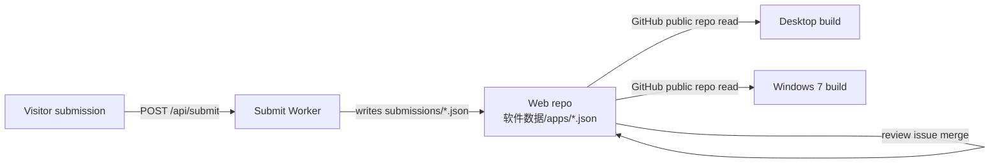

# Welcome to ClassSoftwareHub!

> **A software download hub for classroom-PC administrators**
> No ads, no bundled junk, open source first.

::: warning System compatibility
The Windows 7 build requires **Windows 7 SP1 or later (x64)**. Below that version the installer refuses to install and redirects you to the web site.
The WinUI 3 desktop build requires **Windows 10 1809 or later**. Both use different install directories and install identities, so they can coexist on the same machine.
:::

::: tip No runtime required
Desktop builds are **self-contained**, so no separate .NET runtime is needed. The WebView2 runtime is optional; without it only the in-app web overlay is unavailable.
:::

::: info License
This project is open source under **GNU GPL-3.0**. You may use, modify and distribute it freely, but modified versions must be released under GPL-3.0 as well.
:::

# What is it?

**ClassSoftwareHub** is a software download site and classroom toolbox for AV-equipment administrators. It curates system tools, teaching software, teaching aids and utilities, publishing version numbers, sizes, OS limits and checksums alongside direct download links. It also ships local-only tools such as random name drawing, classroom timers, a full-screen clock, encoding and hashing, Markdown preview, QR code generation, timestamp conversion and OS mirror links.

The project consists of three repositories forming three delivery forms:

| Form | Repository | Tech | OS |
| --- | --- | --- | --- |
| Web | `ClassSoftwareHub` | Vue 3 + Vite + TypeScript static site | Any modern browser |
| Desktop | `ClassSoftwareHub-Desktop` | WinUI 3 + .NET 10 + Windows App SDK 2.5 | Windows 10 1809+ |
| Windows 7 build | `ClassSoftwareHub-windows7` | Avalonia 11.2.8 + .NET 6 | Windows 7 SP1+ (x64) |

## Core strengths

- **Clean catalogue**: no ads, no bundled junk, open source first
- **One file per app**: software data lives in individual JSON files, so a single malformed entry never takes the site down
- **Automatic version tracking**: weekly checks against GitHub Releases and vendor download sources
- **Transparent checksums**: MD5 / SHA families detected by length, one click to copy
- **Consistent across forms**: both desktop builds share the same software data as the web site
- **Runs on old machines**: the Windows 7 build lowers the floor to SP1

## Use cases

- **Bulk provisioning**: pick clean software for classroom PCs and download in batches
- **Old machines**: use the desktop client where the OS cannot be upgraded past Windows 7
- **Classroom tools**: random drawing, timers, full-screen clock, screen capture and pin-up
- **OS mirror navigation**: trusted download entry points for system images; the site stores no images

## How data flows

Both desktop builds **ship no bundled content**. On first launch they must go online and read the web repository's `软件数据/apps/*.json` directly. The reason: bundled leftovers would resurrect delisted software, and bundled copy files would freeze in the cache forever.

## Versioning and release

- **Web**: public `X.Y.Z` plus a codename suffix, plus an internal `AAAABBCCPRDD` number
- **Windows 7 build**: `dv` + `major.feature.patch` + `-insider<arch>.<iteration>`
- **Release isolation**: the Windows 7 build and the WinUI 3 build release and update independently

## Getting help

- Site: [classsoftwarehub.us.ci](https://classsoftwarehub.us.ci)
- Mirror: [classsoftwarehub.132614.xyz](https://classsoftwarehub.132614.xyz)
- Issues: [GitHub Issues](https://github.com/c1201y/ClassSoftwareHub/issues)
- QQ group: 487903798
